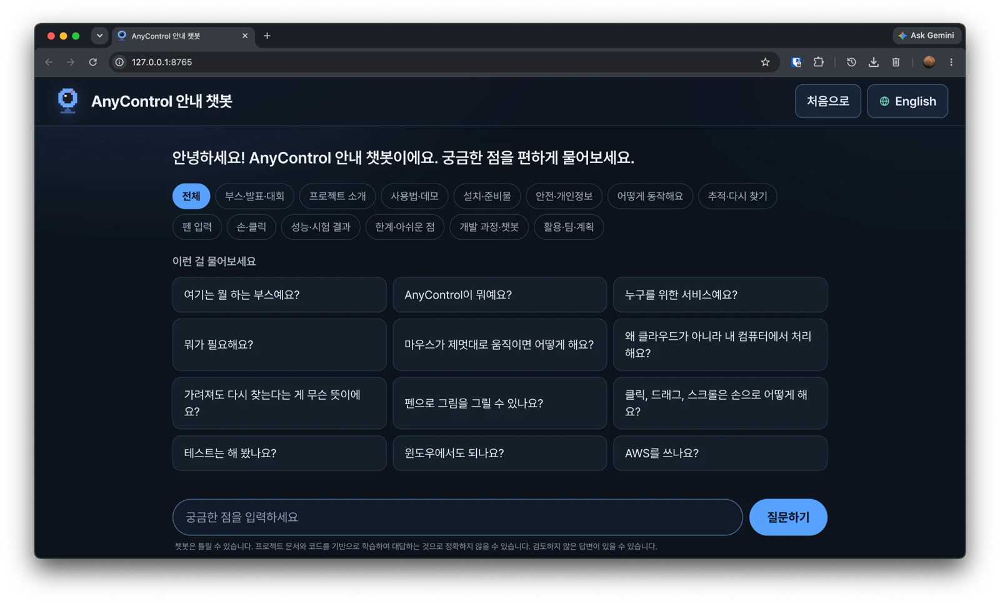
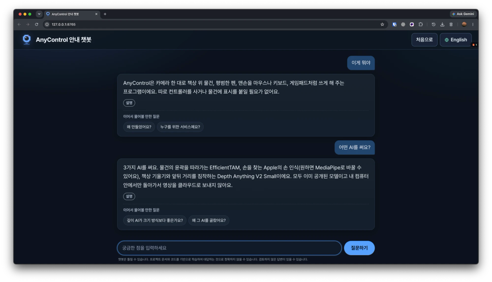

[한국어](README.md) | [English](README-en.md)

<div align="center">

# AnyControl Guide Chatbot

**A Korean/English guide chatbot that answers questions about AnyControl on your own computer — no internet needed**


The booth and demo guide chatbot for [AnyControl](https://github.com/maboloar/anycontrol).



</div>

## Features

- **Card answers** — Searches 409 hand-written question-and-answer cards (Korean and English) and shows them as written. It never makes answers up.
- **Honest fallbacks** — If no card is close enough, it says "Did you mean…?" or "Not in my materials".
- **Korean by default, English available** — The first screen is always Korean; switch to English with the button at the top right.
- **Natural question handling** — Fixes casual speech and typos, and handles follow-up questions.
- **Fully offline** — Questions and logs never leave the computer; it uses only the Python standard library.
- **Local AI assist (optional)** — Turn on a Qwen model to better understand vague questions. The answer text is always the original card.

| Home | Conversation |
|---|---|
|  |  |

## Quick start

You only need [Python 3.9 or later](https://www.python.org/downloads/). No extra packages or internet.

```bash
git clone https://github.com/maboloar/anycontrol-chat.git
cd anycontrol-chat
python3 run_chat.py        # Windows: py -3 run_chat.py
```

The browser opens automatically at `http://127.0.0.1:8765`. If the port is busy, the next one is used. Close the terminal window or the browser tab to quit.

You can also double-click: **Mac** `run.command`, **Windows** `run.bat`.

- On Mac, if you see an "unidentified developer" warning, **right-click → Open**; for a permission error run `bash run.command`.
- On Windows, if SmartScreen appears, choose **More info → Run anyway**.

### Options

```bash
python3 run_chat.py --port 9000     # choose a port
python3 run_chat.py --keep-alive    # keep running after the browser closes
python3 run_chat.py --no-llm        # turn Qwen off
python3 run_chat.py --no-chat       # turn small-talk mode off
```

## Enable Qwen (optional)

The chatbot works fine without it. The model file (about 1 GB) is not in the repository, so download it yourself to use it.

1. Download `qwen2.5-1.5b-instruct-q4_k_m.gguf` from [Qwen2.5-1.5B-Instruct GGUF](https://huggingface.co/Qwen/Qwen2.5-1.5B-Instruct-GGUF) and put it in `models/`.
2. Restart the chatbot and it turns on automatically. If it is too slow on this computer, it turns itself off.

## Troubleshooting

| Problem | Fix |
|---|---|
| The browser doesn't open | Open the address shown in the terminal. |
| `python3` not found | Install Python 3.9 or later (use `py -3` on Windows). |
| "Not in my materials" appears | No card covers it. Rephrase or pick from the topic chips. |
| Qwen doesn't turn on | Check that a `.gguf` is in `models/` with `python3 tools/use_model.py`. |

## For developers

```bash
python3 -m bot validate                # validate cards
python3 -m bot eval                    # run evaluation questions
python3 -m unittest discover -s tests  # tests
python3 tools/build_cards.py           # kb_src/*.txt → kb/cards/*.json
python3 tools/sync_check.py            # check for AnyControl updates (see UPDATE_GUIDE.md)
```

Folders: `bot/` server and search, `kb/` Q&A cards, `kb_src/` card sources, `web/` UI, `tools/` utilities, `tests/` tests.

## Security and privacy

- The server listens only on `127.0.0.1` by default and has no authentication. Opening it with `--host 0.0.0.0` lets anyone on the same network ask questions.
- Visitor questions are stored in `log/` **on this computer only** and are excluded from GitHub by `.gitignore`.
- It is set up to share no personal information about team members beyond their affiliation.
- The chatbot can be wrong; a notice is always shown at the bottom of the screen.
