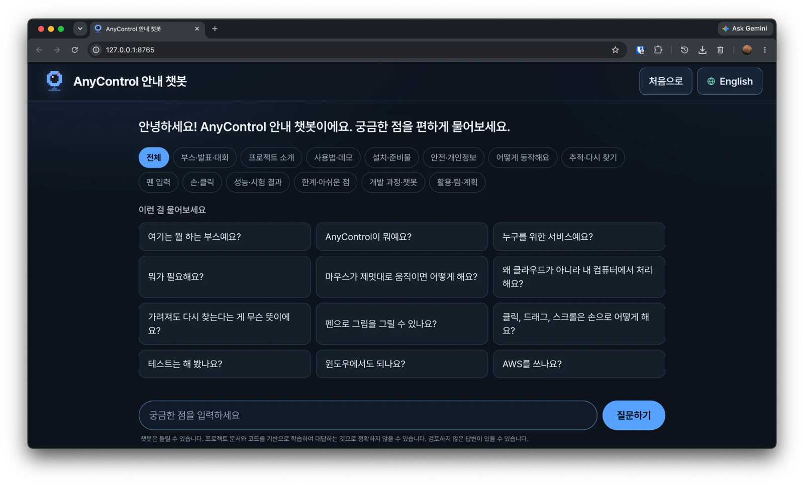
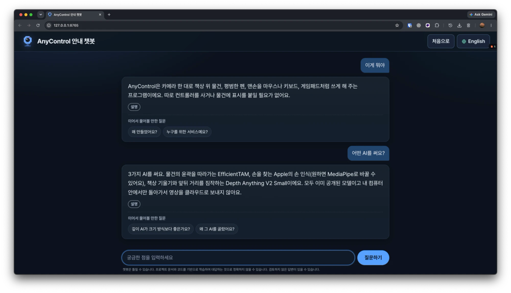

[한국어](README.md) | [English](README-en.md)

<div align="center">

# AnyControl 안내 챗봇

**AnyControl이 궁금한 사람은 누구나 — 인터넷 없이 내 컴퓨터에서 바로 답해 주는 한국어·영어 안내 챗봇**


[AnyControl](https://github.com/maboloar/anycontrol)의 부스·시연용 안내 챗봇입니다.



</div>

## 주요 기능

- **카드 답변** — 사람이 다듬은 질문-답 카드 409장(한국어·영어)을 검색해 그대로 보여 줍니다. 답을 지어내지 않습니다.
- **정직한 대응** — 가까운 카드가 없으면 "혹시 이런 질문인가요?" 또는 "자료에 없어요"로 답합니다.
- **한국어 기본 + 영어** — 처음 화면은 항상 한국어이고, 오른쪽 위 버튼으로 영어로 바꿀 수 있습니다.
- **자연스러운 질문 이해** — 구어체·반말·오타를 고치고, 이어 묻기도 받습니다.
- **완전 오프라인** — 질문과 로그가 컴퓨터 밖으로 나가지 않으며, Python 표준 라이브러리만 씁니다.
- **로컬 AI 보조 (선택)** — Qwen 모델을 켜면 애매한 질문을 더 잘 이해합니다. 답 본문은 항상 카드 원문입니다.

| 첫 화면 | 대화 화면 |
|---|---|
|  |  |

## 빠른 시작

[Python 3.9 이상](https://www.python.org/downloads/)만 있으면 됩니다. 추가 패키지·인터넷은 필요 없습니다.

```bash
git clone https://github.com/maboloar/anycontrol-chat.git
cd anycontrol-chat
python3 run_chat.py        # Windows: py -3 run_chat.py
```

브라우저가 자동으로 열리고 `http://127.0.0.1:8765`에서 쓸 수 있습니다. 포트가 사용 중이면 다음 포트로 자동 이동합니다. 끝내려면 터미널 창이나 브라우저 탭을 닫으세요.

더블클릭으로도 실행됩니다: **Mac** `run.command`, **Windows** `run.bat`.

- Mac에서 "확인되지 않은 개발자" 경고가 뜨면 **우클릭 → 열기**, 실행 권한 오류는 `bash run.command`.
- Windows에서 SmartScreen이 뜨면 **추가 정보 → 실행**.

### 옵션

```bash
python3 run_chat.py --port 9000     # 포트 지정
python3 run_chat.py --keep-alive    # 브라우저를 닫아도 계속 실행
python3 run_chat.py --no-llm        # Qwen 끄기
python3 run_chat.py --no-chat       # 잡담 모드 끄기
```

## Qwen 켜기 (선택)

없어도 챗봇은 정상 작동합니다. 저장소에는 모델 파일(약 1GB)이 없으므로 쓰려면 직접 받아야 합니다.

1. [Qwen2.5-1.5B-Instruct GGUF](https://huggingface.co/Qwen/Qwen2.5-1.5B-Instruct-GGUF)에서 `qwen2.5-1.5b-instruct-q4_k_m.gguf`를 받아 `models/`에 넣습니다.
2. 챗봇을 다시 시작하면 자동으로 켜집니다. 이 컴퓨터에서 느리면 스스로 꺼집니다.

## 문제 해결

| 문제 | 해결 방법 |
|---|---|
| 브라우저가 열리지 않음 | 터미널에 표시된 주소를 직접 엽니다. |
| `python3`를 찾을 수 없음 | Python 3.9 이상을 설치합니다 (Windows는 `py -3`). |
| "자료에 없어요"가 나옴 | 카드에 없는 질문입니다. 표현을 바꾸거나 주제 칩에서 골라 보세요. |
| Qwen이 켜지지 않음 | `models/`에 `.gguf`가 있는지 `python3 tools/use_model.py`로 확인합니다. |

## 개발자용

```bash
python3 -m bot validate                # 카드 검증
python3 -m bot eval                    # 평가 질문 실행
python3 -m unittest discover -s tests  # 테스트
python3 tools/build_cards.py           # kb_src/*.txt → kb/cards/*.json
python3 tools/sync_check.py            # AnyControl 업데이트 점검 (UPDATE_GUIDE.md 참고)
```

폴더: `bot/` 서버·검색, `kb/` 질문-답 카드, `kb_src/` 카드 원본, `web/` 화면, `tools/` 도구, `tests/` 테스트.

## 보안 및 개인정보

- 서버는 기본적으로 `127.0.0.1`에만 열리고 인증이 없습니다. `--host 0.0.0.0`으로 열면 같은 네트워크의 누구나 질문할 수 있습니다.
- 방문객 질문은 `log/`에 **이 컴퓨터에만** 저장되며 `.gitignore`로 GitHub에 올라가지 않습니다.
- 팀원 개인정보는 소속 외에는 답하지 않도록 되어 있습니다.
- 챗봇은 틀릴 수 있으며, 화면 아래에 항상 안내 문구가 표시됩니다.
